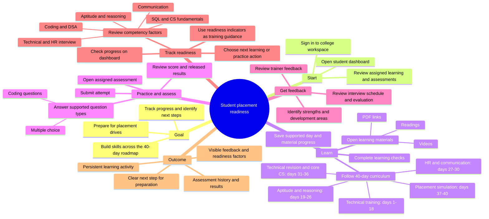

# TalentEdge: Major Features and Top Use Cases

**Reviewed version:** `0e46df0` (`v1 Pilot version`)  
**Product:** College-first placement-readiness and placement-program operations portal.

This overview reflects the current source, API authorization map, feature guide, and pilot documentation. Integrations such as email, AI, code execution, and payment processing require separate provider setup before they are available in a deployment.

## Major features

### 1. Role-based, college workspaces

- Separate college workspaces isolate each institution's users, students, batches, learning activity, interviews, and reports.
- College roles cover students, trainers, interview panelists, and college administrators. A separate platform administrator role operates the platform console.
- The server enforces role capabilities and workspace/resource scope on protected APIs; platform administration uses a separate session and permission registry.
- Invitation-based onboarding, password reset/change, member activation/deactivation, role and batch assignment, and workspace audit history support account lifecycle management.

### 2. Student placement-readiness journey

- A student dashboard brings together assigned learning, assessment activity, progress, interview results, trainer feedback, profile, and readiness indicators.
- The 40-day curriculum covers technical training (days 1–18), aptitude/reasoning (19–26), HR/communication (27–30), technical revision/core CS (31–36), and placement simulation (37–40).
- Students can open workspace materials and learning checks and save supported curriculum/material progress.
- Student profiles show competency factors, strengths/development areas, interview feedback, and readiness classifications.

### 3. Assessments and coding practice

- College administrators/trainers can create or manage assessments within their permitted scope; students take assigned assessments and review released results.
- Assessment workflows support question sections, versions, availability/due dates, attempt rules, late submissions, scoring, trainer review, and result release.
- MCQ scoring is server-side. Coding runs are sent to a separately hosted Judge0 service with server-owned tests and configured resource limits; the integration must be configured and secured by the operator.

### 4. Batch, curriculum, and student management

- College teams create and manage batches, enroll/invite students, assign trainers, and review student records within the workspace.
- Trainers see students and batches allowed by their assignments.
- Workspace learning materials can be created, edited, archived, and assigned; student progress is stored separately from material definitions.

### 5. Interview scheduling and evaluation

- Administrators maintain panelists and schedule, update, or cancel technical and HR interviews.
- Assigned panelists view their interviews and submit rubric evaluations and remarks.
- Students can view their schedules, evaluation results, and follow-up information. Administrators can review schedule history and interview reports.

### 6. Analytics, reports, and exports

- Dashboards and reports summarize batch/student progress, assessment activity, interview activity, and (where entitled) placement outcomes.
- Filters and date ranges support targeted operational reviews; available outputs include student PDF reports and batch/report CSV exports.
- Readiness is a versioned weighted score across competency indicators, with configurable workspace thresholds. Placement outcome evaluation is descriptive and requires recorded outcomes; it is not a calibrated probability or hiring recommendation.

### 7. Optional AI assistance

- When explicitly enabled and configured, Gemini can provide student recommendations and trainer batch summaries.
- The server has deterministic/heuristic fallback responses when external AI is not enabled or available; fallback output is not model-generated.
- Successful provider usage is metered against workspace AI credits. AI output and readiness indicators are advisory and should not drive admissions, hiring, discipline, or placement decisions.

### 8. Workspace plans, usage, and billing

- The plan catalog defines features and limits for Pilot, Campus, and Campus Plus, including active-student, trainer-seat, batch, and AI-credit allowances.
- College administrators can view subscription status, plan period, and usage. Eligible administrators can start Razorpay subscription checkout, cancel at period end, and access payment/invoice history.
- Server-side entitlement checks gate selected actions and features. Billing requires configured Razorpay credentials, approved plan prices, and verified webhooks. Tax/GST calculation and invoice-address self-service are not included.

### 9. Platform operations console and shared content

- A separate MFA-protected `/platform-admin` console supports workspace provisioning/lifecycle, administrator invitations, plan configuration, subscription changes/history, platform-admin management, and audit review.
- Platform operators can draft and publish versioned shared curriculum materials and assessment sets, apply releases to selected colleges, inspect rollout history, and roll back through a new application operation.
- Platform operations are designed around workspace-level metadata and do not grant access to student learning records.

### 10. Account email and operational support

- When Resend is configured, the app can send invitations and supported account lifecycle messages; email attempt status/errors are stored for workspace administrators to inspect.
- Health/readiness endpoints, request IDs, MySQL migrations, demo seeding, and database backup commands support deployment and operations.
- Email provider acceptance is recorded; it does not confirm inbox delivery. Bounce synchronization and scheduled interview/calendar reminders are not implemented.

## Top use cases

| # | Use case | Primary roles | Typical workflow | Outcome |
|---|---|---|---|---|
| 1 | **Run a student through a placement-readiness program** | Student, trainer | Student follows the 40-day roadmap, reviews materials, completes learning checks and assigned assessments, then reviews scores and feedback. | The student has a persistent view of learning activity, assessment results, and readiness factors. |
| 2 | **Set up a college cohort** | College administrator, trainer | Create a batch, invite students, assign the trainer, and let the trainer open the assigned batch. | The college can organize its cohort and give staff scoped access to student progress. |
| 3 | **Find students who need support** | Trainer, college administrator | Review batch analytics and at-risk/readiness indicators, inspect student factors, then plan and track follow-up. | Staff can target coaching and practice using visible training signals. |
| 4 | **Evaluate an assessment attempt** | Student, trainer | Student submits an MCQ or coding attempt; the system scores supported questions; trainer reviews submissions and releases feedback/results. | Attempt history and feedback are available to the student and authorized staff. |
| 5 | **Conduct a mock interview cycle** | College administrator, panelist, student | Add panelist, schedule an interview, have the assigned panelist submit a rubric evaluation, then let the student review results and follow-up. | The interview appointment and evaluation are connected across roles and available for reporting. |
| 6 | **Prepare a placement-program review** | College administrator | Filter activity, assessment, interview, or placement-outcome reports and export a CSV or student PDF. | Staff can share a scoped snapshot for internal program follow-up. |
| 7 | **Operate multiple college customers** | Platform administrator | Provision a workspace, invite its administrator, configure plan/status, review usage and audit history. | Platform operations can support colleges without mixing their tenant data. |
| 8 | **Distribute centrally maintained learning content** | Platform administrator, college administrator | Create and publish a shared-content release, apply it to a selected workspace, inspect the result, and roll back if needed. | Colleges can receive versioned central materials while retaining local student progress and workspace customizations. |
| 9 | **Manage a college subscription** | College administrator, platform administrator | Review plan and usage, select a priced plan and complete Razorpay authorization, then review invoice/payment history or schedule cancellation. | Subscription state and entitlements can be managed through the configured billing provider. |
| 10 | **Onboard and recover user accounts** | College administrator, platform administrator, user | Issue an invitation or reset link, activate/deactivate membership, and inspect recorded account email attempts. | Staff can manage access and users can recover accounts through one-time flows. |

## Mind map: student placement-readiness journey

## Role summary

| Role | Main jobs |
|---|---|
| **Student** | Follow assigned curriculum, take assessments, track personal progress, review interview feedback and readiness details, and maintain permitted profile fields. |
| **Trainer** | Work with assigned batches, monitor progress, manage permitted learning/assessment activity, review submissions, and give feedback/evaluations. |
| **Interview panelist** | View assigned interviews and submit evaluation rubrics and feedback. |
| **College administrator** | Configure a workspace, manage members/batches/materials/interviews, inspect reports, and manage subscription/billing. |
| **Platform administrator** | Provision and support workspaces, manage plans/subscriptions/shared content/platform accounts, and review platform audit information. |

## Important implementation boundaries

- Judge0, Resend, Gemini, and Razorpay are external services; the corresponding environment credentials and provider-side setup are required.
- Coding assessment execution is isolated in a separately hosted Judge0 service; it is not run inside the TalentEdge web server.
- Gemini external processing is disabled unless explicitly enabled. Readiness is deterministic and advisory; outcome metrics depend on labeled historical outcomes and are descriptive.
- Some visible UI areas remain sample, derived, or partially persisted; verify the owning screen and API before treating every control as a full data-management workflow.
- Recruiter/ATS synchronization and college-system roster integration are not implemented.
- For detailed scope and setup, see [FEATURE_GUIDE.md](FEATURE_GUIDE.md), [API_AUTHORIZATION.md](API_AUTHORIZATION.md), [AI_GOVERNANCE.md](AI_GOVERNANCE.md), and [V1_PILOT_DEPLOYMENT_CHECKLIST.md](V1_PILOT_DEPLOYMENT_CHECKLIST.md).
